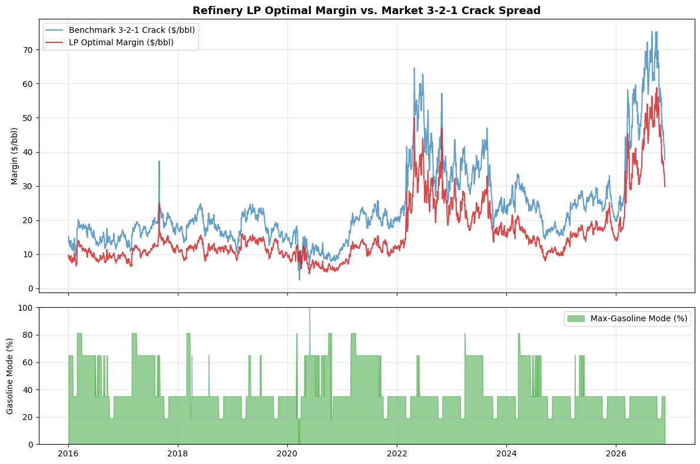
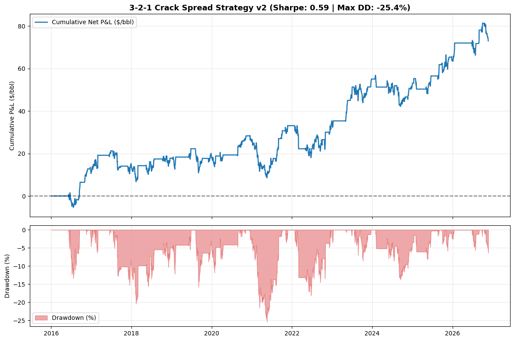

# Refinery Crack Spread & Yield Optimization Model

A Python and SQLite quantitative modeling project combining chemical engineering refinery constraints with systematic commodities trading on the NYMEX 3-2-1 crack spread.

## 1. Project Overview
* **Data Pipeline (`step1_build_db.py`):** Pulls 10 years of daily NYMEX front-month futures for WTI Crude (`CL=F`), RBOB Gasoline (`RB=F`), and ULSD Heating Oil (`HO=F`), handles barrel/gallon conversions (42 gal/bbl), filters the April 2020 negative WTI anomaly, and stores clean time series in a local SQLite database.
* **Refinery Linear Program (`step2_refinery_lp.py`):** Queries SQLite and solves a daily linear program (`scipy.optimize.linprog`) for a 100,000 bbl/day refinery choosing between Light Sweet (WTI) and Heavy Sour (WCS) crudes across Max-Gasoline and Max-Distillate operating modes, subject to CDU, FCC, hydrocracker, coker, and seasonal turnaround constraints.
* **Systematic Backtest (`step3_backtest.py`):** Tests a 60-day rolling Z-score mean-reversion strategy on the 3-2-1 crack spread with 1-day execution lag (`.shift(1)`) to eliminate look-ahead bias and $0.05/bbl round-trip transaction costs.

## 2. Refinery LP Results

## 3. Backtest Performance & Risk Management
Upgrading from a naive Z-score model (v1) to a risk-managed framework (v2)—adding hysteresis exits, a 3-sigma stop-loss, 20-day volatility-targeted position sizing, and a Feb–Apr spring turnaround short filter—significantly improved risk-adjusted returns:

| Metric | Naive Model (v1) | Risk-Managed Model (v2) |
| :--- | :--- | :--- |
| **Total Trade Events** | 323 | 119 |
| **Cumulative Net P&L** | $24.46 / bbl | $73.02 / bbl |
| **Annualized Sharpe Ratio** | 0.15 | 0.59 |
| **Max Drawdown** | -51.20% | -25.40% |

## 4. Key Limitations & Model Risks
* **Futures Roll Yield:** Yahoo Finance continuous front-month series (`=F`) do not adjust for contango/backwardation roll costs between contract expirations.
* **Physical Basis & Compliance:** Realized refinery margins depend on regional crude differentials (e.g., Cushing vs. USGC) and RIN biofuel compliance costs not captured in headline NYMEX futures.
